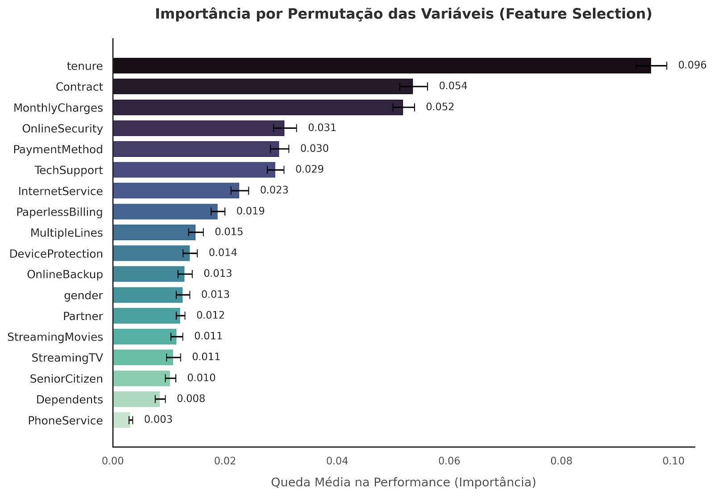
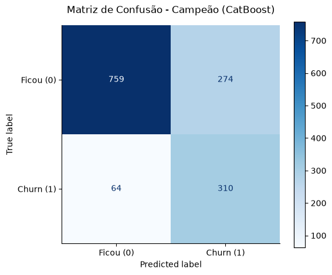
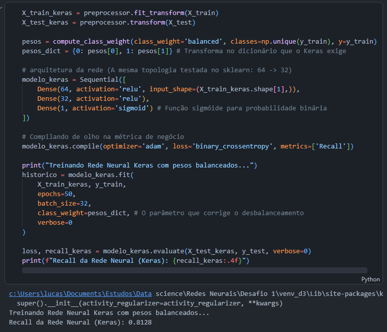

$$\text{ Redes Neurais Artificiais (Aprendizado Profundo) - Desafio 3  }$$
$$\text{ Lucas Reges Lima }$$

# Introdução

No setor de telecomunicações, a retenção de clientes é frequentemente mais crítica e lucrativa do que quando falamos de aquisição. O 'Churn' representa a taxa de evasão, ou seja, o percentual de clientes que cancelam seus serviços e cessam o seu relacionamento com a empresa em um determinado período. Associado a isso está o conceito de LTV (Lifetime Value - Valor do Tempo de Vida do Cliente), que mensura o lucro líquido que um cliente gera para a empresa durante todo o seu relacionamento.

Neste ínterim, o problema de negócio que pegamos reside em modelar o Churn da Telco a partir de um dataset no Kaggle, disponível em “Telco Customer Churn”  que se traduz em um desafio de machine learning de classificação com classes desbalanceadas. O custo de um Erro Tipo II (falso-negativo: o modelo prevê que o cliente vai ficar, mas ele cancela) é a perda integral do seu LTV. Por outro lado, o custo do erro tipo I (falso-positivo: o modelo prevê cancelamento e a empresa oferece um desconto preventivo, mas o cliente já iria manter o relacionamento) é apenas a margem desse incentivo. Portanto, a modelagem deste projeto foi ancorada na maximização do Recall (métrica), forçando os algoritmos a penalizarem severamente os falsos-negativos como uma forma de combater a desigualdade de classes.

## Análise

A etapa de pré-processamento focou em buscar quais variáveis eram realmente relevantes ao modelo. Utilizei o método de *Permutation Importance* (do Scikit-learn) para realizar a seleção de variáveis, descartando ruídos e mantendo os preditores mais importantes para o Churn, como o tipo de contrato, serviços de segurança online e suporte técnico. Nessa fase, passei da analise univariada das features à multivariada, buscando separar o joio do trigo e entender o que mais influencia o cliente a passar pelo evento de Churn. Concluí que o tipo de contrato que o cliente assina (variável `contract`), o tempo de casa (`tenure`) e o uso dos serviços extras como: `InternetService, PaperlessBilling, InternetService` também são fortes pontos que grudam o cliente no negócio e consecutivamente podem beneficiar o LTV.

Para garantir que a análise estivesse protegida contra Data Leakage, toda a transformação (normalização via ``StandardScaler`` e binarização via ``One-Hot Encoding``) foi isolada dentro de pipelines dinâmicos acoplados à validação cruzada. Modelos de gradient boosting (CatBoost e LightGBM) foram alimentados diretamente com os dados categóricos nativos, aproveitando a otimização interna de suas árvores sem a esparsidade gerada pelo One-Hot, que é mais do que bem vinda para os modelos que chamamos de "clássicos": Regressão Logística com penalização, Random Forest e Rede Neural MLP.

    
{width=500px}

A arena de testes contou com algoritmos de naturezas distintas (exatamente os citados acima) e o guardrail de validação do experimento foi um GridSearchCV com 5 folds, guiado exclusivamente pelo Recall, pois como mencionado é a métrica que nos é mais cara nesse contexto. O grande diferencial do projeto foi a manipulação algébrica da Loss Function. Através do parâmetro ``class_weight="balanced"``, o erro cometido ao ignorar um cliente de churn foi multiplicado (penalizando-o em uma proporção aproximada de 3 para 1 em relação à classe majoritária), forçando os modelos a assumirem uma postura mais agressiva contra a evasão em detrimento da acurácia global (que não foi tão prejudicada assim).

| Arquitetura | Recall | ROC-AUC | Hiperparâmetros vencedores (GridSearch) |
|:---|:---:|:---:|:---|
| **CatBoost** | 82.89% | 84.83% | auto_class_weights = Balanced depth = 4 learning_rate = 0.01 |
| **Random Forest** | 82.62% | 84.49% | class_weight = balanced max_depth = 5 min_samples_leaf = 1 n_estimators = 100 |
| **Elastic Net** | 79.95% | 84.01% | class_weight = balanced C = 0.1 l1_ratio = 0.9 |
| **LightGBM** | 78.88% | 84.40% | class_weight = balanced learning_rate = 0.01 num_leaves = 31 |
| **MLP (Rede Neural)** | 52.94% | 81.54% | hidden_layer_sizes = (64, 32, 16) alpha = 0.01 learning_rate_init = 0.01 |

O CatBoost foi o campeão aqui do desafio, atingindo um recall de 82.88% aliado a um ROC-AUC de 84.83%. Sua capacidade de ingerir dados categóricos nativos (até mesmo texto) somada à ponderação automática de classes provou ser muito boa na separação das distribuições não-lineares, superando arquiteturas que dependem de matrizes esparsas como os modelos dependentes de one-hot. A matriz de confusão mostra a estratégia aboirdada: de 374 possíveis cancelamentos no conjunto de teste isolado, o modelo capturou 310 clientes reais (garantindo o LTV), deixando escapar apenas 64. O "pedágio" operacional de 274 falsos-positivos é financeiramente suportável (eu imagino) e superado pelo montante de receita que foi protegida da possível perda. É fácil de imaginar que, às vezes nós mesmos somos alvo dessas políticas de retensões em e-commerce por exemplo, quando achamos que somos especiais, mas na verdade estamos recebendo um cupom milagroso porque algum modelo nos enquadrou por ai como possível churn.

    
{width=500px}

Um dos achados mais ricos da experimentação envolvendo as Redes Neurais foi que a implementação nativa do Scikit-Learn apresentou um recall inicial de meros 52.9%. Este número humilde não foi decorrente da topologia, mas de uma limitação da biblioteca, que não suporta a injeção do balanceamento de classes durante o cálculo. Consequentemente, a rede minimizou o erro priorizando a classe majoritária. No entanto, o ROC-AUC de 81.5% do modelo base indicou que a rede profunda (64 e 32 neurônios ocultos) mapeou até que bem os padrões de churn, mas traçou o threshold de decisão de forma equivocada. Para comprovar empiricamente essa tese eu fiz um bônus: a arquitetura foi migrada para o framework de tensores Keras/TensorFlow, com ajuda do Gemini Pro, pois não tenho familiaridade com a modelagem nessa bibliotecas. 

E o resultado confirmou a premissa: o recall saltou instantaneamente para 81.28%, provando que as redes neurais possuem formidável poder preditivo quando sua função de custo é alinhada aos objetivos de negócio, tendo as ferramentas certas em mãos.

    
{width=500px}

## Conclusão

Este desafio foi além da simples importação e treino de algoritmos preditivos, consolidando um ciclo analítico de ponta a ponta (guardadas as devidas proporções). Desde a seleção de preditores e organização via pipelines contra Data Leakage até a tunagem dos parâmetros. O experimento comprovou que a maximização de uma métrica de negócio, como o LTV, reside não apenas na escolha da tecnologia, mas na capacidade de traduzir a dor de negócio na matemática que nos tangiu até tomarmos uma postura punitiva quanto ao modo de funcionamento do nosso gradiente descendente via balanço de classes. O estimador hiper-parametrizado do CatBoost emergiu como uma solução robusta e imediatamente aplicável para campanhas produtivas de retenção. Concluo que as redes neurais não são "bala de prata", mesmo em problemas de predição (sem apelo causal), onde há campo para resolvermos as coisas de forma satisfatória com modelos mais simplórios e que permitem mais explicabilidade.
